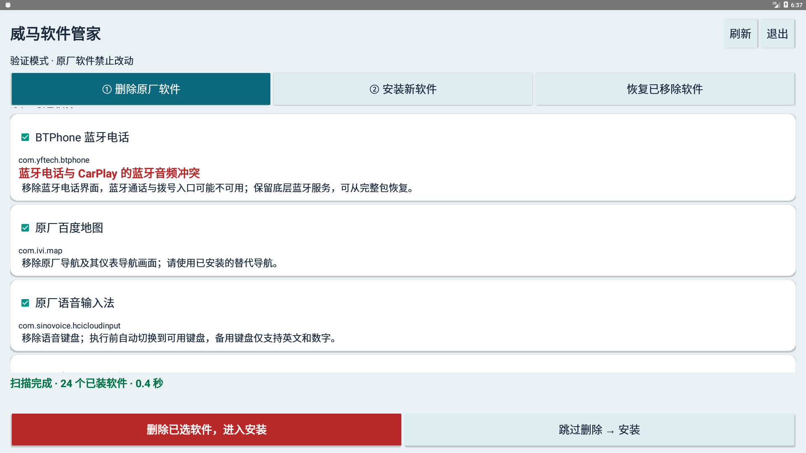
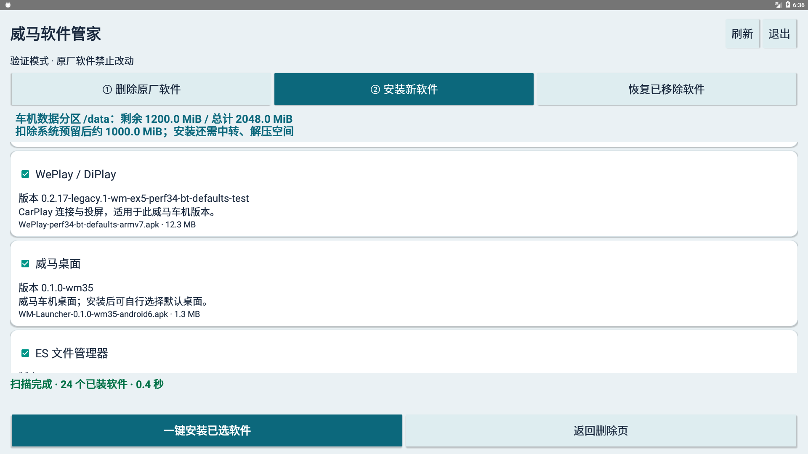
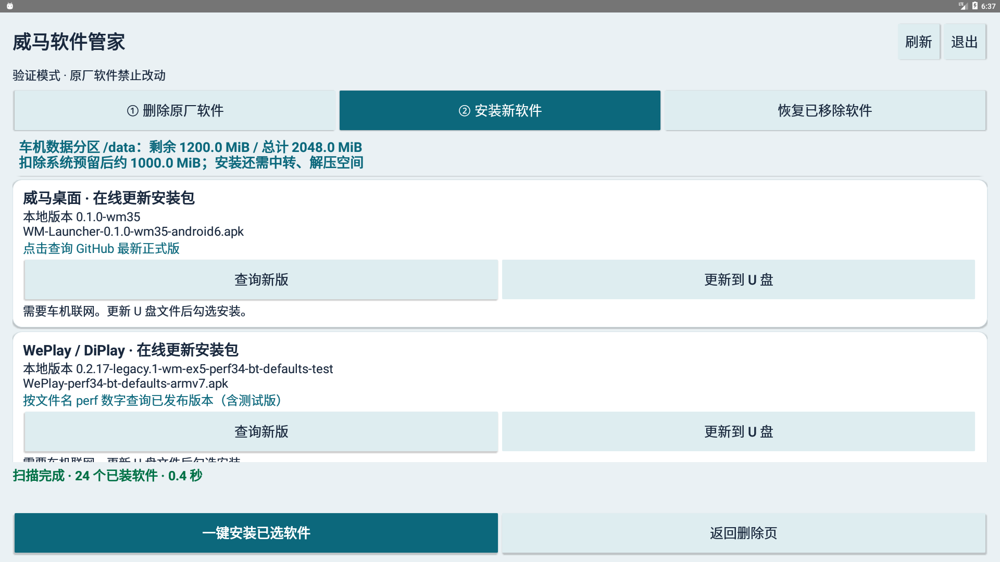
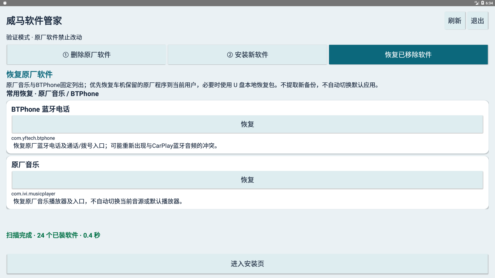

# WM Software Manager · 威马软件管家

A touch-friendly software manager for supported WM Android 6 head units. Start it through the factory USB entry to remove applications, install APKs, restore factory software, and check Launcher / WePlay updates.

[Download Full / Lite](https://github.com/naojiren/wm-usb-manager/releases/latest) · [简体中文](README.md) · [Build instructions](docs/BUILD.md)

## Screenshots

Actual app screenshots from validation mode in an Android 6 emulator using read-only sample data. Application lists, counts and available storage are examples, not measurements from a vehicle. The app UI is in Chinese.

| Remove software | Install APKs |
| --- | --- |
|  |  |
| **Online updates** | **Factory restore — Full** |
|  |  |

Click an image to view it at full size.

## Features

- Remove allowlisted factory applications and eligible third-party software. Other system, vehicle and active essential services remain protected.
- Scan the USB root `apk` folder, show application descriptions and versions, and batch-install selected packages.
- Restore factory software in Full using retained system APKs or the supplied local factory packages. Music and BTPhone have permanent shortcuts.
- Manually check GitHub releases for WM Launcher and WePlay. WePlay uses the numeric `perf` suffix: a larger number is newer.
- Show available data-partition storage and large, color-coded processing/results messages.
- Optionally inspect and clear recognized historical temporary files, preserving backups, application data and files in use.
- Keep the manager on the vehicle for software removal and Launcher / WePlay updates without carrying the full USB bundle.

## Choose an edition

| Edition | Bundled applications | Factory restore | Best for |
| --- | --- | --- | --- |
| Full | Default and optional APKs; see the release inventory | Local factory packages and restore page included | Complete software management and factory recovery |
| Lite | ADB tool, WePlay / DiPlay, WM Launcher, ES File Explorer and Force Rotation | No recovery files or restore page | Common applications with a smaller USB bundle |

Application versions, experimental status and per-release changes belong in [Releases](https://github.com/naojiren/wm-usb-manager/releases). See [BUILD](docs/BUILD.md) for development instructions.

## Prepare and start the USB

1. Download a `full.zip` or `lite.zip` asset from the [latest release](https://github.com/naojiren/wm-usb-manager/releases/latest). GitHub's **Source code** ZIP is not a head-unit installation bundle.
2. Extract its contents directly into the USB root, without an extra enclosing folder. Preserve all bootstrap files and the `wm_manager` directory.
3. When upgrading an existing USB, exit the old manager first. Remove obsolete APKs according to **删除旧文件清单.txt**. Overlay extraction does not remove old files; other user-added APKs may remain.
4. Insert the USB into a supported head unit and start through the factory USB entry. The UI appears first, then scans applications and packages. Wait for scanning to finish.
5. Operate while parked. Save required Amap favorites, account state, settings and offline maps before installation.

```text
USB root/
├─ factorymodel
├─ certificates.xml
├─ yfautorun.sh
├─ yfautorun.md5
├─ apk/                         # Add or remove installation APKs here
└─ wm_manager/
   ├─ manager.apk
   ├─ start.sh
   ├─ originals.json            # Full only
   └─ original_apks/            # Full only
```

Start through the complete USB workflow on first use. Installing `manager.apk` alone does not create the privileged worker.

## Usage

### 1. Remove software

Factory Baidu Maps, voice input and BTPhone are checked by default and can be unchecked. Other applications are optional; third-party software is listed separately and unchecked. Continue with removal or skip directly to installation.

BTPhone has a red Bluetooth / CarPlay audio conflict warning. Removing it may disable the factory phone/dialer entry; use Full to restore it when needed. Normal removal preserves application data and the factory system APK.

### 2. Select and install APKs

The default selections are the ADB tool, WePlay / DiPlay, WM Launcher, ES File Explorer and Force Rotation. Select any other required APKs, then use the batch-install button.

- Add or remove APKs in the root `apk` directory and refresh the list.
- Select only one APK per application. Incompatible or older packages show a reason.
- Runtime permissions can be granted automatically; special permissions such as overlays may still require manual setup.
- WM Launcher defaults to system-partition installation, which can be disabled. Follow the restart prompt after writing it.
- Available space must also cover staging, extraction and the system reserve.

**Amap installation clears application data.** An incompatible signing identity for an ordinary Amap package triggers a full uninstall before the selected APK is installed. System applications, multiple users or unverifiable states stop automatic replacement; the manager does not retry indefinitely.

### Restore factory software — Full

Open the restore page and select the application's restore button. Factory Music and BTPhone are listed first. The manager prefers re-enabling the retained system package, then falls back to the USB recovery APK. It does not extract a new backup or automatically change default applications/audio sources.

This restores the application, not previously erased user data. Use Full when factory recovery is needed; Lite has no restore page.

### Check Launcher / WePlay updates

Use the corresponding update-check button on the installation page. The head unit needs GitHub access. Downloads are checked for identity, signature, version and hash. USB mode updates the package file, which you then select for installation; vehicle-resident mode can download and install directly.

### Run without the USB

Use the installation page's option to keep the manager on the vehicle. Opening it from the application list then provides removal and the two managed online updates. Resident operation needs existing `su` authorization. Enabling ADB alone does not provide this authorization after a reboot.

## Troubleshooting

**Privilege channel unavailable / `Connection refused`**
The UI cannot reach its privileged worker. Exit, reinsert the complete USB bundle and start through the factory entry. If it still fails, inspect `/data/local/tmp/wm-usb-manager/bootstrap.log` and `worker.log`. Factory startup and privilege behavior depend on head-unit firmware.

**Does “0 MiB reclaimable” mean the disk is full?**
No. Reclaimable space counts eligible temporary files only. Available data-partition storage is shown at the top of the installation page.

**No APKs found**
Check the USB root layout, the `apk` folder and the bootstrap files. Refresh after adding packages.

**Installation fails or a third-party app behaves unexpectedly**
Read the specific result message. App requirements, experimental status and known limitations are documented in Releases and the bundled application notes.
